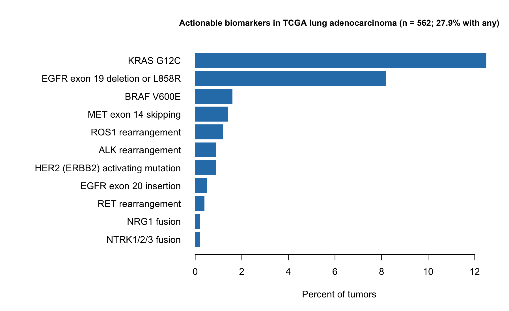

# Oncology Treatment Access Navigator (NSCLC) - Phase 1

**Live demo:** https://gendeanna.shinyapps.io/oncology-navigator/ (may take 15 seconds to wake up)

An R Shiny prototype that helps oncology clinicians and financial coordinators
reduce treatment delays for non-small cell lung cancer (NSCLC).

## The problem
Cancer treatment is often delayed because biomarker testing is incomplete
(so the right drug can't be chosen yet) or because insurance prior
authorization stalls. Clinical and financial teams usually work in separate systems.

## What the app does
- **Reads NGS results** in MAF format and maps variants to actionable biomarkers
- **Flags testing gaps**: biomarkers with an FDA-approved therapy but no result on file
- **Matches FDA-approved therapies** by biomarker, stage, histology, line of therapy and PD-L1 level
- **Shows coverage information**: Part B vs Part D billing, HCPCS codes, typical
  prior-auth patterns by payer type, NGS test coverage notes (NCD 90.2, CMS-0057-F),
  and a prior-auth document checklist

## How to run it
1. Open `OncologyNavigator.Rproj` in RStudio
2. In the Console, run `renv::restore()` to install the same package versions
3. Open `app.R` and click **Run App**

## Tests
Run `testthat::test_dir("tests/testthat")` (16 automated checks).

## Real-data validation (TCGA lung adenocarcinoma)
The variant classifier was applied to 562 tumors from the TCGA Lung Adenocarcinoma
PanCancer Atlas study (cBioPortal), combining mutation and fusion data
(`scripts/tcga_analysis.R`).

- **27.9% of tumors (157/562)** carried a biomarker with an FDA-approved targeted therapy for NSCLC
- Most common: KRAS G12C (12.5%) and EGFR exon 19 deletion / L858R (8.2%)
- No tumor carried more than one actionable driver, reproducing the known mutual
  exclusivity of lung cancer driver alterations

*Caveats: TCGA tumors are mostly early-stage resected adenocarcinomas; some therapies
(e.g., KRAS G12C inhibitors) are approved only after prior treatment; exon-level calls
use simplified codon rules. Results describe biomarker prevalence, not treatment eligibility.*
## Data sources
- Therapy rules: hand-built from FDA prescribing information (DailyMed / openFDA).
  Each rule is marked with the date it was verified against the current label.
- Patients: synthetic only. No real patient data.
- NCCN Guidelines are copyrighted and are not reproduced.

## Disclaimer
Portfolio prototype for education and decision support. Not a medical device.
Treatment decisions belong to the treating clinician; coverage must be confirmed with the payer.

## Roadmap
- Phase 2: CIViC API variant annotation, ClinicalTrials.gov matching, patient-assistance programs
- Phase 3: delay dashboard using public payer prior-auth metrics, PDF handoff report
- Phase 4: mCODE-aligned data model and automated testing on GitHub

## Author
DeAnna Genthner - M.S. Bioinformatics student, University of Maryland Global Campus